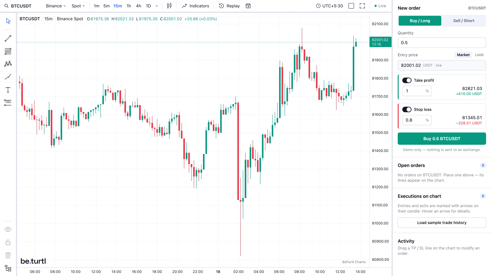

<p align="center">
  
</p>

<h1 align="center">BeTurtl Charts</h1>

<p align="center">
  Professional trading charts for React and TypeScript — real-time candles, 110+ indicators,
  85 drawing tools, 21 chart types and multi-chart layouts.<br />
  By <a href="https://prasaninfotech.in">Prasan Infotech LLP</a>.
</p>

<p align="center">
  
</p>

This repository is a **ready-to-run demo and starter project**. It contains the compiled BeTurtl Charts
packages (in [`vendor/`](vendor)) and a React app that uses them: the full trading terminal with live
market data and a demo order panel. Clone it, run it, and copy what you need into your own app.

> **License:** free for **noncommercial use only**. **Commercial use is not permitted at this time** —
> commercial licenses are coming soon, and we'll notify you once they're available. See [Licensing](#licensing).
> See [Licensing](#licensing).

---

## Contents

- [Features](#features)
- [Quick start](#quick-start)
- [Project structure](#project-structure)
- [Example: a custom datafeed](#example-a-custom-datafeed)
- [Add BeTurtl Charts to your own project](#add-beturtl-charts-to-your-own-project)
- [The trading terminal (`TradingTerminal`)](#the-trading-terminal-tradingterminal)
- [Working with the chart from code](#working-with-the-chart-from-code)
- [Drawings](#drawings)
- [Indicators](#indicators)
- [Orders: trade lines and execution markers](#orders-trade-lines-and-execution-markers)
- [Symbols, timeframes and chart types](#symbols-timeframes-and-chart-types)
- [Navigation, bar replay and events](#navigation-bar-replay-and-events)
- [Timezones](#timezones)
- [Multi-chart layouts](#multi-chart-layouts)
- [Saving drawings and indicators to your backend](#saving-drawings-and-indicators-to-your-backend)
- [Market data: exchanges and custom datafeeds](#market-data-exchanges-and-custom-datafeeds)
- [A single chart without the terminal](#a-single-chart-without-the-terminal)
- [Theme and branding](#theme-and-branding)
- [License key](#license-key)
- [Deploying](#deploying)
- [Reference lists](#reference-lists)
- [Licensing](#licensing)
- [Support](#support)

---

## Features

| | |
|---|---|
| **Real-time data** | 12 exchanges built in — Binance, Bybit, OKX, Coinbase, Kraken, KuCoin, Hyperliquid, Gate.io, Bitfinex, Bitstamp, CoinDCX, Delta Exchange (spot and futures) — or **your own data feed in the full terminal** (stocks, forex, your broker, …). |
| **85 drawing tools** | Trend lines, rays, channels, pitchforks, Fibonacci and Gann tools, harmonic and Elliott patterns, long/short positions, measure, shapes, text, notes, tables, images and more. Drawings can extend past the live candle. |
| **110+ indicators** | Moving averages, oscillators, trend, volatility, volume, momentum, Bill Williams, pivot points and statistics — overlays or separate panes, with full settings. |
| **21 chart types** | Candles, hollow/volume candles, Heikin Ashi, bars, line, area, baseline, columns, high-low, Renko, Kagi, Point & Figure, Line Break, Range, TPO, volume footprint, session volume profile. |
| **Multi-chart layouts** | Up to 16 charts, with symbol, interval, crosshair, time and date-range sync. |
| **Trading** | Draggable entry / take-profit / stop-loss lines with live P&L, and buy/sell execution markers. |
| **Bar replay** | Replay any market candle by candle from a chosen date. |
| **Timezones** | One timezone setting for every chart (UTC, local or any city). |
| **Saving** | Export and restore drawings and indicators; plug in your own backend. |
| **React or plain TS** | A complete `<TradingTerminal />`, a `<ChartContainer />`, or the framework-free `TradingChart` class. |

---

## Quick start

Requirements: **Node.js 20+** and npm.

```bash
git clone https://github.com/prasan-infotech-llp/beturtl-charts.git
cd beturtl-charts
npm install
npm run dev
```

Open <http://localhost:5173> — the full trading terminal with live market data and a demo order panel.

**Try a custom datafeed:** flip the **Custom datafeed** switch in the top bar (or open
<http://localhost:5173/?feed=custom>). The terminal switches from live Binance crypto to an example
datafeed of NSE stocks — Reliance, TCS, Infosys, HDFC Bank — with simulated prices and live ticks.
See [Example: a custom datafeed](#example-a-custom-datafeed).

Other scripts:

| Command | What it does |
|---|---|
| `npm run dev` | Development server with hot reload |
| `npm run build` | Type-check and build to `dist/` |
| `npm run preview` | Serve the production build locally |

---

## Project structure

```
.
├── vendor/                     Compiled BeTurtl Charts packages (installed by npm install)
│   ├── trading-core-0.0.0.tgz        @trading/core       — chart engine, drawings, indicators
│   ├── trading-datafeed-0.0.0.tgz    @trading/datafeed   — exchange feeds + custom datafeed API
│   ├── trading-chart-0.0.0.tgz       @trading/chart      — TradingChart (data loading, replay, …)
│   ├── trading-react-chart-0.0.0.tgz @trading/react-chart — <ChartContainer /> for React
│   └── trading-terminal-0.0.0.tgz    @trading/terminal   — <TradingTerminal /> complete UI
├── src/
│   ├── main.tsx                Entry point
│   ├── App.tsx / App.css       Demo page: terminal + order panel (shows the trading APIs in use)
│   ├── Navbar.tsx / .css       Top bar: logo + switch between Binance and the custom datafeed
│   ├── datafeeds/
│   │   └── relianceDatafeed.ts Example custom datafeed (NSE stocks, simulated) — copy this pattern
│   ├── OrderSidebar.tsx / .css Demo order form, open orders and activity log
│   └── orders.ts               Fake order "backend" used by the demo
├── public/                     Logos and images
├── vite.config.ts              Dev server + proxy for exchanges that block browser requests
├── .env.example                License key variable
├── LICENSE                     PolyForm Noncommercial 1.0.0
└── COMMERCIAL-LICENSE.md       Commercial use: not permitted yet (licenses coming soon)
```

---

## Example: a custom datafeed

[`src/datafeeds/relianceDatafeed.ts`](src/datafeeds/relianceDatafeed.ts) is a complete datafeed written
from scratch — the template for connecting your own broker or market-data API. It serves NSE stocks
(Reliance, TCS, Infosys, HDFC Bank) with **simulated** prices:

| Method | What it does in the example | What yours would do |
|---|---|---|
| `resolveSymbol` | Returns name, `exchange: "NSE"`, 2-decimal prices | Look the symbol up in your API |
| `getHistory` | Returns a page of candles before `to` (or from `startTime`), with `noData` at the ends | Call your candles endpoint |
| `subscribeBars` | Moves the live candle every second and pushes it | Subscribe to your WebSocket / stream |
| `unsubscribeBars`, `destroy` | Stop the timer when no chart is watching | Close the stream |

It also exports the symbol list and timeframes for the terminal. The demo plugs it in like this
([`App.tsx`](src/App.tsx)):

```tsx
import { NSE_RESOLUTIONS, NSE_SYMBOLS, RelianceDatafeed } from "./datafeeds/relianceDatafeed";

const customDatafeed = useMemo(() => new RelianceDatafeed(), []); // create once, share with every chart

<TradingTerminal
  key={feed} // remount when switching: the terminal picks its data source when it starts
  symbol="RELIANCE"
  datafeed={customDatafeed}
  symbols={NSE_SYMBOLS}
  resolutions={NSE_RESOLUTIONS}
  datafeedLabel="NSE"
/>;
```

To use your real data, keep the class and replace the simulated generator (`nextMinute`, `_history`,
`_tick`) with calls to your API. Everything else — drawings, indicators, orders, replay — works unchanged.

> The terminal remembers each mode's last symbol, layout and drawings, so reopening the custom
> datafeed returns to the stock you last viewed.

---

## Add BeTurtl Charts to your own project

### 1. Install the packages

Copy the `vendor/` folder into your project (or point at this repo's copy) and install all five
packages. They depend on each other, so install them together:

```bash
npm install ./vendor/trading-core-0.0.0.tgz ./vendor/trading-datafeed-0.0.0.tgz \
            ./vendor/trading-chart-0.0.0.tgz ./vendor/trading-react-chart-0.0.0.tgz \
            ./vendor/trading-terminal-0.0.0.tgz
```

The React packages need **React 18 or 19** (`react` and `react-dom`).

### 2. Show the terminal

```tsx
import { TradingTerminal } from "@trading/terminal";
import "@trading/terminal/styles.css";

export default function App() {
  return (
    <div style={{ height: "100vh" }}>
      <TradingTerminal symbol="BTCUSDT" resolution="15" />
    </div>
  );
}
```

The terminal fills its parent element — **give the parent a height.**

### 3. Exchange proxy (only some exchanges)

Binance, Bybit, OKX, Coinbase, Kraken spot, Gate.io, Bitstamp, Hyperliquid and Delta work straight from
the browser. **KuCoin, Bitfinex, CoinDCX and Kraken Futures** block browser requests, so the charts call
them through same-origin paths (`/api/ex/<exchange>/…`) that your server must forward. With Vite, copy
this project's [`vite.config.ts`](vite.config.ts) — it builds the proxy from `proxyRoutes()`:

```ts
import { proxyRoutes } from "@trading/datafeed";

proxyRoutes();
// [{ path: "/api/ex/kucoin", target: "https://api.kucoin.com" }, { path: "/api/ex/bitfinex", … }, …]
```

Or send those calls to your own backend: `setExchangeRest({ kucoin: "https://your-api.example.com/kucoin" })`.

---

## The trading terminal (`TradingTerminal`)

The complete charting UI in one component: top toolbar (symbol search, exchange, market, timeframes,
chart type, indicators, replay, go-to-date, timezone, layout, fullscreen), drawing toolbar, legends,
price-axis menu and multi-chart layouts.

```tsx
<TradingTerminal
  symbol="ETHUSDT"
  exchange="bybit"
  market="futures"
  resolution="60"
  chartType="candlestick"
  layout="2v"
  timeZone="Asia/Kolkata"
  licenseKey={import.meta.env.VITE_BETURTL_LICENSE_KEY}
  theme={{ upColor: "#26a69a", downColor: "#ef5350" }}
  onReady={(chart) => console.log("chart ready", chart)}
  onSymbolChange={(symbol, market, exchange) => console.log(symbol, market, exchange)}
/>
```

### Props

| Prop | Type | Default | Description |
|---|---|---|---|
| `symbol` | `string` | `"BTCUSDT"` | Starting symbol. |
| `exchange` | `ExchangeId` | `"binance"` | Starting exchange — see [exchanges](#exchanges). |
| `market` | `"spot" \| "futures" \| "coin_m" \| "options"` | `"spot"` | Starting market. |
| `resolution` | `Resolution` | `"15"` | Starting timeframe — see [timeframes](#timeframes). |
| `chartType` | `ChartType` | `"candlestick"` | Starting chart type — see [chart types](#chart-types). |
| `layout` | `ChartLayoutId` | `"1"` | Starting layout — see [layouts](#multi-chart-layouts). |
| `timeZone` | `string` | `"local"` | `"local"`, `"UTC"` or an IANA name like `"America/New_York"`. |
| `licenseKey` | `string` | — | Commercial license key (licenses coming soon); removes the watermark. |
| `logoUrl` | `string` | — | Your logo, drawn in the chart's bottom-left corner. |
| `theme` | `Partial<ChartTheme>` | — | Chart colours — see [theme](#theme-and-branding). |
| `chartOptions` | `Partial<TradingChartOptions>` | — | Extra options passed to every chart. |
| `datafeed` | `IDatafeed` | built-in exchanges | **Your own data feed** — see [full terminal on your own data](#full-terminal-on-your-own-data). (A `BinanceDatafeed` keeps the built-in exchanges and routes Binance through it.) |
| `symbols` | `TerminalSymbol[] \| () => Promise<TerminalSymbol[]>` | — | Your feed's symbols for symbol search. |
| `resolutions` | `Resolution[]` | all | Timeframes your feed supports; the timeframe menu shows only these. |
| `datafeedLabel` | `string` | — | Source name in the chart legend, e.g. `"NSE"` (when symbols don't report one). |
| `drawingStore` | `DrawingStore \| null` | localStorage | Where drawings are saved; `null` disables saving. |
| `drawingKey` | `(info) => string` | `"exchange:market:symbol:resolution"` | Key drawings are saved under. |
| `indicatorStore` | `IndicatorStore \| null` | localStorage | Where each chart's indicators are saved. |
| `indicatorKey` | `(slot) => string` | `"chart-0"` … `"chart-15"` | Key indicators are saved under. |
| `storageKey` | `string \| null` | built-in | localStorage key for price-axis settings. |
| `layoutStorageKey` | `string \| null` | built-in | localStorage key for layout, symbols, intervals, sync and timezone. |
| `onReady` | `(chart: TradingChart) => void` | — | Called with each chart instance whenever a chart is (re)created. |
| `onSymbolChange` | `(symbol, market, exchange) => void` | — | The selected chart's symbol changed. |
| `onResolutionChange` | `(resolution) => void` | — | The selected chart's timeframe changed. |
| `onLayoutChange` | `(layout) => void` | — | The user picked another layout. |
| `onTimeZoneChange` | `(zone) => void` | — | The user picked another timezone. |
| `onFullscreenChange` | `(fullscreen: boolean) => void` | — | Fullscreen entered / left. |
| `className`, `style` | | — | Applied to the terminal's root element. |

> The terminal saves its state (layout, symbols, drawings, indicators) in the browser by default. Pass
> `layoutStorageKey={null}`, `drawingStore={null}` and `indicatorStore={null}` for a fresh start every time.

---

## Working with the chart from code

`onReady` gives you the `TradingChart` instance. The terminal **recreates the chart when the symbol or
timeframe changes**, so `onReady` runs again — keep the latest instance in a ref and re-apply anything you
drew from code (see the demo's [`App.tsx`](src/App.tsx)).

```tsx
import { useRef } from "react";
import { TradingTerminal, type TradingChart } from "@trading/terminal";

function MyTerminal() {
  const chartRef = useRef<TradingChart | null>(null);

  return (
    <TradingTerminal
      symbol="BTCUSDT"
      onReady={(chart) => {
        chartRef.current = chart;
        const last = chart.engine.bars.at(-1); // latest candle: { time, open, high, low, close, volume }
        if (last) chart.createDrawing({ type: "horizontal_line", points: [{ time: last.time, price: last.close }] });
      }}
    />
  );
}
```

**Times are unix seconds** (candle open time). **Prices** are plain numbers.

---

## Drawings

### Add a drawing

`createDrawing` places any of the 85 tools by time and price and returns its id:

```ts
const now = Math.floor(Date.now() / 1000);
const hour = 3600;

// Trend line: two points
chart.createDrawing({
  type: "trendline",
  points: [{ time: now - 48 * hour, price: 81200 }, { time: now - 6 * hour, price: 82400 }],
  color: "#2962ff",
});

// Horizontal support line: one point
chart.createDrawing({ type: "horizontal_line", points: [{ time: now, price: 80500 }], color: "#089981" });

// Fibonacci retracement from a swing low to a swing high
chart.createDrawing({
  type: "fib_retracement",
  points: [{ time: now - 72 * hour, price: 79800 }, { time: now - 12 * hour, price: 83100 }],
});

// Rectangle zone
chart.createDrawing({
  type: "rectangle",
  points: [{ time: now - 30 * hour, price: 81900 }, { time: now - 20 * hour, price: 81500 }],
  color: "#f23645",
});

// Text label
chart.createDrawing({ type: "text", points: [{ time: now - 10 * hour, price: 82800 }], text: "Breakout" });

// Long position: entry, target (its time is where the box ends), stop
chart.createDrawing({
  type: "long_position",
  points: [
    { time: now - 4 * hour, price: 81800 }, // entry
    { time: now + 20 * hour, price: 83000 }, // target
    { time: now + 20 * hour, price: 81200 }, // stop
  ],
});

// Arrow mark on a candle, locked so users can't move it
chart.createDrawing({ type: "arrow_mark_up", points: [{ time: now - 8 * hour, price: 81000 }], locked: true });
```

Points may lie **in the future** (right of the live candle) — useful for projections and targets.

How many points each tool needs (a few common ones):

| Points | Tools |
|---|---|
| 1 | `horizontal_line`, `horizontal_ray`, `vertical_line`, `cross_line`, `text`, `note`, `price_label`, `table`, `arrow_mark_up`, `arrow_mark_down`, `anchored_vwap`, `flag_mark`, `pin` |
| 2 | `trendline`, `ray`, `extended_line`, `info_line`, `arrow`, `fib_retracement`, `rectangle`, `callout`, `measure`, `price_range`, `date_range`, `regression_trend` |
| 3 | `parallel_channel`, `pitchfork`, `fib_extension`, `ellipse`, `triangle`, `long_position` / `short_position` (entry, target, stop) |
| 5–7 | `xabcd` (5), `elliott_impulse` (6), `head_shoulders` (7) |

`POINTS_REQUIRED` from `@trading/core` has the exact count for every tool. The full list of tool names
is under [Reference lists](#drawing-tools).

### DrawingInput

```ts
interface DrawingInput {
  type: DrawingType;                       // tool, e.g. "trendline"
  points: { time: number; price: number }[];
  id?: string;                             // your own id (generated if omitted)
  label?: string;                          // name shown in the object list
  color?: string;
  visible?: boolean;
  locked?: boolean;                        // users can't move or edit it
  text?: string;                           // text tools: the text
  style?: DeepPartial<DrawingStyle>;       // any tool setting (line width, dash, fib levels, …)
}
```

Style example — a dashed, thicker line that extends right:

```ts
chart.createDrawing({
  type: "trendline",
  points: [{ time: t1, price: p1 }, { time: t2, price: p2 }],
  style: { lineWidth: 2, lineStyle: "dashed", extendRight: true },
});
```

Tables are pinned to the chart window (not to a candle):

```ts
chart.createDrawing({
  type: "table",
  points: [{ time: now, price: 0 }],
  style: {
    textTool: {
      table: {
        position: "top_right", // top_left … bottom_right, or "free" with screenX / screenY (0–1)
        rows: 3,
        cols: 2,
        cells: [["Level", "Price"], ["Entry", "81,800"], ["Target", "83,000"]],
        headerColor: "#2962ff", // optional — anything you leave out keeps its default
      },
    },
  },
});
```

### Change, remove and read drawings

```ts
chart.updateDrawing(id, { color: "#ff9800", points: [/* new points */], locked: true, text: "Updated" });
chart.updateDrawingStyle(id, { lineWidth: 3 });
chart.toggleDrawingVisibility(id);
chart.selectDrawing(id);            // or null to deselect
chart.removeDrawing(id);
chart.clearDrawings();

chart.getDrawings();                // every drawing (points as bar positions)
chart.exportDrawings();             // { version, savedAt, drawings: [{ type, points: [{ time, price }], style, … }] }
chart.loadDrawings(savedLayout);    // replace all drawings with a saved layout
```

### Keyboard

**Delete** or **Backspace** removes the selected drawing (not while typing in a field, and never a locked
drawing). **Escape** cancels a drawing in progress; **Enter** finishes a path or polyline.

### Let the user draw

```ts
chart.setActiveTool("fib_retracement"); // next clicks place a Fibonacci retracement
chart.setActiveTool("cursor");          // back to normal ("crosshair" also works)
```

### Drawing events

```ts
chart.onDrawingFinished((id) => console.log("user finished drawing", id));
chart.onDrawingsChange((drawings) => console.log("drawings changed", drawings.length));
chart.onDrawingSelection((id) => console.log("selected", id));
```

Each `on…` method returns a function that removes the listener.

---

## Indicators

```ts
const emaId = chart.addIndicator("ema", { length: 50 });
const rsiId = chart.addIndicator("rsi", { length: 14 });
chart.addIndicator("bb", { length: 20, mult: 2 });
chart.addIndicator("macd", { fast: 12, slow: 26, signal: 9 });

chart.updateIndicatorParams(emaId!, { length: 200 });
chart.toggleIndicatorVisibility(rsiId!);
chart.removeIndicator(rsiId!);

chart.getActiveIndicators();       // what's on the chart
const saved = chart.exportIndicators();
chart.loadIndicators(saved);       // restore
chart.onIndicatorsChange((active) => console.log(active.length, "indicators"));
```

Common indicator ids and their parameters:

| Id | Parameters (defaults) |
|---|---|
| `sma`, `ema`, `wma`, `hma` | `length: 9`, `offset: 0` |
| `ichimoku` | `conversion: 9`, `base: 26`, `span2: 52`, `displacement: 26` |
| `rsi` | `length: 14` |
| `macd` | `fast: 12`, `slow: 26`, `signal: 9` |
| `bb` (Bollinger Bands) | `length: 20`, `mult: 2`, `offset: 0` |
| `supertrend` | `atrLength: 10`, `factor: 3` |
| `atr` | `length: 14` |
| `stoch` | `k: 14`, `kSmooth: 1`, `d: 3` |
| `vwap`, `volume`, `obv`, `adx`, `cci`, … | see [the full list](#indicators-1) |

Browse every indicator from code: `INDICATOR_CATALOG`, `INDICATOR_CATEGORIES`, `searchIndicators("moving")`
and `getIndicatorsByCategory("trend")` from `@trading/core`.

---

## Orders: trade lines and execution markers

### Entry, take-profit and stop-loss lines

```ts
const entry = chart.createTradeLine({
  id: "ORD-1:entry",
  kind: "entry",             // "entry" | "tp" | "sl" | "custom"
  price: 81800,
  side: "long",              // "long" | "short"
  quantity: 0.5,
  currency: "USDT",
  cancellable: true,         // shows ✕ on the label
});

const tp = chart.createTradeLine({ kind: "tp", label: "TP", price: 83000, entry, cancellable: true });
const sl = chart.createTradeLine({ kind: "sl", label: "SL", price: 81200, entry, cancellable: true });

// TP / SL are draggable; the label shows live P&L measured from `entry`.
tp.onDrag((price, pnl) => console.log("dragging", price, pnl));
tp.onDragEnd(async (price, previous) => {
  try {
    await myApi.modifyTakeProfit("ORD-1", price);
  } catch {
    tp.setPrice(previous);   // rejected: snap back
  }
});
sl.onCancelClick(() => sl.remove());
entry.onCancelClick(() => closeOrder("ORD-1"));

// Update later
tp.setPrice(83500).setLabel("TP2").setColor("#00897b");
chart.getTradeLine("ORD-1:entry");
chart.getTradeLines();
chart.removeAllTradeLines();
```

`TradeLineOptions`: `kind`, `price`, `label`, `id`, `side`, `quantity`, `entry`, `draggable`, `cancellable`,
`color`, `currency`, `tickSize`, `formatPnl(info, line)`.

### Execution markers (buy / sell arrows)

```ts
const marker = chart.createTradeMarker({
  time: 1760000000,          // unix seconds — attaches to the candle containing it
  price: 81812.4,
  side: "buy",               // "buy" ▲ under the candle | "sell" ▼ above it
  kind: "entry",             // "entry" | "exit"
  quantity: 0.5,
  text: "ORD-1 · opened long",
});
marker.onClick((m) => console.log("clicked", m.price));
marker.remove();

// Whole trade history at once (replaces existing markers)
chart.setTradeMarkers(historyFromYourBackend);
chart.removeAllTradeMarkers();
```

The demo's [`App.tsx`](src/App.tsx) shows a complete order flow: placing orders, dragging TP/SL with a
backend round-trip, closing, and loading trade history.

---

## Symbols, timeframes and chart types

```ts
await chart.setSymbol("ETHUSDT");
chart.setResolution("240");          // 4 hours
chart.setChartType("heikin_ashi");
chart.getSymbolInfo();               // { symbol, name, exchange, pricescale, … }
chart.formatPrice(81812.4);          // price formatted with the symbol's precision
```

With `<TradingTerminal />`, the user changes these from the toolbar; set the starting values with props.

---

## Navigation, bar replay and events

```ts
await chart.goToDate(Date.UTC(2026, 0, 15) / 1000);          // centre on a date → "ok" | "no-data"
await chart.goToRange(fromSec, toSec);                        // show an exact range
chart.setVisibleTimeRange({ from: fromSec, to: toSec }, true);
chart.getVisibleTimeRange();
await chart.scrollToLatest();                                 // back to the live candle

// Bar replay
await chart.startReplay(Date.UTC(2026, 0, 15) / 1000);
chart.setReplaySpeed(5);            // 1 | 2 | 3 | 5 | 10 | 20
chart.playReplay();
chart.pauseReplay();
chart.stepReplayForward();
chart.stepReplayBackward();
chart.onReplayChange((state) => console.log(state.currentTime, state.playing));
chart.exitReplay();

// Events
chart.onCrosshairMove((pos) => pos && console.log(pos.time, pos.price));
chart.onVisibleTimeRangeChange((range) => console.log(range.from, range.to));
chart.onLegendBarChange((bar) => bar && console.log(bar.close));
chart.onLiveEdgeChange((atLiveEdge) => console.log("at latest candle:", atLiveEdge));
```

---

## Timezones

One setting drives every chart on the page. The terminal shows it as a menu in the top bar; from code:

```ts
import { setChartTimeZone, getChartTimeZone, TIME_ZONES } from "@trading/core";

setChartTimeZone("Asia/Kolkata"); // or "UTC", "local", "America/New_York", …
TIME_ZONES;                       // [{ id: "UTC", label: "UTC" }, { id: "Pacific/Honolulu", … }, …]
```

Daily and longer candles keep exchange dates; only intraday times change.

---

## Multi-chart layouts

```tsx
<TradingTerminal layout="4" />
```

Layout ids: `1`, `2v`, `2h`, `3v`, `3h`, `3l`, `3r`, `3t`, `3b`, `4`, `4v`, `4h`, `4l`, `4t`, `4b`, `5l`, `5t`,
`5-23`, `5-32`, `6`, `6c`, `6t`, `7`, `8`, `8c`, `9`, `10`, `12`, `12w`, `16` (the number is how many charts).
`CHART_LAYOUTS` from `@trading/terminal` describes each one. Sync of symbol, interval, crosshair, time and
date range is set from the layout menu.

---

## Saving drawings and indicators to your backend

```tsx
import { TradingTerminal, type DrawingStore, type IndicatorStore } from "@trading/terminal";

const drawingStore: DrawingStore = {
  load: (key) => fetch(`/api/drawings/${encodeURIComponent(key)}`).then((r) => (r.ok ? r.json() : null)),
  save: (key, layout) =>
    fetch(`/api/drawings/${encodeURIComponent(key)}`, {
      method: "PUT",
      headers: { "Content-Type": "application/json" },
      body: JSON.stringify(layout),
    }).then(() => undefined),
};

const indicatorStore: IndicatorStore = {
  load: (key) => fetch(`/api/indicators/${key}`).then((r) => (r.ok ? r.json() : null)),
  save: (key, indicators) =>
    fetch(`/api/indicators/${key}`, { method: "PUT", body: JSON.stringify(indicators) }).then(() => undefined),
};

<TradingTerminal
  drawingStore={drawingStore}
  indicatorStore={indicatorStore}
  drawingKey={({ exchange, market, symbol, resolution }) => `user-42:${exchange}:${market}:${symbol}:${resolution}`}
/>;
```

Drawings are saved per exchange + market + symbol + timeframe; indicators per chart slot. Both methods
may be sync or async.

---

## Market data: exchanges and custom datafeeds

### Exchanges

Built in: `binance`, `bybit`, `okx`, `coinbase`, `kraken`, `kucoin`, `hyperliquid`, `gateio`, `bitfinex`,
`bitstamp`, `coindcx`, `delta`. The terminal's exchange menu switches between them; `EXCHANGES` from
`@trading/datafeed` lists each with its markets. To get a feed in code:

```ts
import { createExchangeDatafeed } from "@trading/datafeed";

const feed = createExchangeDatafeed("bybit", "futures"); // null if that market has no candles (e.g. options)
```

### Your own data

Any object that implements `IDatafeed` works with `<TradingTerminal />`, `<ChartContainer />` and `TradingChart`:

```ts
import type { IDatafeed, HistoryRequest, HistoryResponse, SymbolInfo, SubscribeOptions, BarCallback } from "@trading/datafeed";

class MyDatafeed implements IDatafeed {
  readonly maxBarsPerRequest = 500; // most candles your API returns per call (default 1000)

  onReady(callback: () => void) {
    callback();
  }

  async resolveSymbol(symbol: string): Promise<SymbolInfo> {
    return {
      symbol, name: symbol, description: symbol, exchange: "MyExchange", type: "crypto",
      pricescale: 100, minmov: 1, session: "24x7", timezone: "Etc/UTC",
    };
  }

  async getHistory(req: HistoryRequest): Promise<HistoryResponse> {
    // Backward page: up to req.countBack bars ending at or before req.to.
    // Forward page (req.startTime set): up to req.countBack bars from req.startTime.
    const rows = await fetch(`/api/candles?s=${req.symbol}&tf=${req.resolution}&to=${req.to}&limit=${req.countBack}`)
      .then((r) => r.json());
    const bars = rows.map((r: number[]) => ({ time: r[0], open: r[1], high: r[2], low: r[3], close: r[4], volume: r[5] }));
    return { bars, noData: bars.length < (req.countBack ?? 500) }; // noData: nothing older/newer left
  }

  subscribeBars(options: SubscribeOptions, onBar: BarCallback): string {
    const ws = new WebSocket(`wss://my-feed.example.com/${options.symbol}/${options.resolution}`);
    ws.onmessage = (e) => {
      const m = JSON.parse(e.data);
      onBar({ time: m.t, open: m.o, high: m.h, low: m.l, close: m.c, volume: m.v }, m.closed);
    };
    const id = crypto.randomUUID();
    this.sockets.set(id, ws);
    return id;
  }

  unsubscribeBars(id: string) {
    this.sockets.get(id)?.close();
    this.sockets.delete(id);
  }

  private sockets = new Map<string, WebSocket>();
}
```

Rules: bars are `{ time, open, high, low, close, volume? }` with **`time` = candle open time in unix seconds**,
sorted oldest first. In `subscribeBars`, a bar with the same `time` as the last one updates it; a later
`time` starts a new candle.

**Ready-made feeds** you can configure instead of writing one — from `@trading/datafeed/examples`:

```ts
import { StaticDatafeed, RestPollingDatafeed, WebSocketDatafeed } from "@trading/datafeed/examples";

// Candles you already have (CSV, backtest, database); push() streams updates
const staticFeed = new StaticDatafeed({ bars: { MYSYM: oneMinuteBars }, baseResolution: "1" });
staticFeed.push("MYSYM", latestBar);

// A REST candles endpoint; live candle by polling
const restFeed = new RestPollingDatafeed({
  maxBarsPerRequest: 500,
  historyUrl: (r) => `https://api.example.com/candles?s=${r.symbol}&tf=${r.resolution}&end=${r.to}&limit=${r.countBack}`,
  parseHistory: (body) => (body as number[][]).map(([t, o, h, l, c, v]) => ({ time: t, open: o, high: h, low: l, close: c, volume: v })),
});

// REST history + WebSocket stream
const wsFeed = new WebSocketDatafeed({
  historyUrl: (r) => `https://api.example.com/candles?s=${r.symbol}&tf=${r.resolution}&end=${r.to}&limit=${r.countBack}`,
  parseHistory: (body) => (body as number[][]).map(([t, o, h, l, c, v]) => ({ time: t, open: o, high: h, low: l, close: c, volume: v })),
  streamUrl: () => "wss://stream.example.com",
  subscribeMessage: (o) => JSON.stringify({ op: "subscribe", channel: `candles.${o.resolution}.${o.symbol}` }),
  parseMessage: (data) => {
    const m = JSON.parse(data);
    return m.type === "candle" ? { bar: { time: m.t, open: m.o, high: m.h, low: m.l, close: m.c, volume: m.v }, isClosed: m.final } : null;
  },
});
```

### Full terminal on your own data

Pass your datafeed to `<TradingTerminal />` and you get the **complete terminal** — toolbar, drawing
tools and their settings, indicators, replay, go-to-date, layouts, timezones — on your data:

```tsx
import { TradingTerminal, type TerminalSymbol } from "@trading/terminal";

const datafeed = new MyDatafeed(); // any IDatafeed — your class, or a ready-made feed from @trading/datafeed/examples

const symbols: TerminalSymbol[] = [
  { symbol: "RELIANCE", name: "Reliance Industries", description: "NSE · Equity" },
  { symbol: "TCS", name: "Tata Consultancy Services", description: "NSE · Equity" },
  { symbol: "INFY", name: "Infosys", description: "NSE · Equity" },
];

<TradingTerminal
  datafeed={datafeed}
  symbols={symbols}                              // or: symbols={() => fetch("/api/symbols").then((r) => r.json())}
  resolutions={["1", "5", "15", "60", "D"]}      // only what your data supports
  datafeedLabel="NSE"
  symbol="RELIANCE"                              // optional — defaults to the first symbol
/>;
```

With your own feed the terminal:

- uses it for **every chart** in the layout (create the feed once — outside the component or in `useMemo`);
- hides the exchange and market menus;
- searches `symbols` by id, name and description — and users can also type any symbol and press Enter,
  so `symbols` is optional;
- shows the symbol's `exchange` from your `resolveSymbol` (or `datafeedLabel`) in the legend;
- saves drawings under `custom:<market>:<symbol>:<resolution>` and the layout under its own key, so they
  never mix with exchange data.

---

## A single chart without the terminal

### React: `<ChartContainer />`

```tsx
import { ChartContainer, useDatafeed } from "@trading/react-chart";
import { StaticDatafeed } from "@trading/datafeed/examples";
import type { OHLCVBar } from "@trading/core";

function MyChart({ bars }: { bars: OHLCVBar[] }) {
  const datafeed = useDatafeed(() => new StaticDatafeed({ bars: { MYSYM: bars } }));
  return (
    <div style={{ height: 500 }}>
      <ChartContainer
        datafeed={datafeed}
        symbol="MYSYM"
        resolution="15"
        chartType="candlestick"
        onReady={(chart) => chart.addIndicator("ema", { length: 20 })}
      />
    </div>
  );
}
```

`useDatafeed` creates the feed once per component. `ChartContainer` takes every `TradingChart` option plus
`chartType`, `activeTool`, `className`, `style`, `onReady` and `onChartUnmount`.

### Plain TypeScript / any framework: `TradingChart`

```ts
import { TradingChart } from "@trading/chart";
import { createExchangeDatafeed } from "@trading/datafeed";

const chart = new TradingChart(document.getElementById("chart")!, {
  datafeed: createExchangeDatafeed("binance", "spot")!, // null only for markets without candles
  symbol: "BTCUSDT",
  resolution: "15",
  licenseKey: "BTC1.…",
});
await chart.init();          // loads the symbol and history, starts live updates
chart.setChartType("candlestick");
chart.setActiveTool("cursor");

// later
chart.destroy();
```

Every method in this README is available on the `TradingChart` instance.

---

## Theme and branding

```tsx
<TradingTerminal
  theme={{
    background: "#ffffff",
    grid: "#f0f3fa",
    text: "#131722",
    upColor: "#089981",
    downColor: "#f23645",
    crosshair: "#9598a1",
  }}
  logoUrl="/my-logo.png"
/>
```

`ChartTheme`: `background`, `grid`, `text`, `upColor`, `downColor`, `crosshair`, and optional
`axisBackground`, `axisHoverBackground`, `axisBorder`, `crosshairLabelBackground`. Per-chart-type styles
(candle colours, Renko box size, …) are in the chart settings dialog, or `chart.setChartStyle(...)`.

---

## License key

Noncommercial use needs no key; charts show a small **"BeTurtl Charts"** credit. Commercial licenses
(**coming soon**) will come with a key for your domains that removes it:

```bash
cp .env.example .env.local
# VITE_BETURTL_LICENSE_KEY=BTC1.…
```

```tsx
<TradingTerminal licenseKey={import.meta.env.VITE_BETURTL_LICENSE_KEY} />
// or: new TradingChart(el, { …, licenseKey }) / chart.setLicenseKey(key)
```

- Checked **offline** in the browser — nothing is sent anywhere.
- Covers the domains on your license and their subdomains; `localhost` always works for development.
- Needs `https` (or localhost).
- An invalid or expired key never breaks the chart: the credit simply stays, and the browser console says why.
- `chart.isLicensed` tells you whether the key was accepted.

---

## Deploying

`npm run build` writes a static site to `dist/`. Your host needs two things:

1. **Single-page app fallback** — serve `index.html` for any route your own app adds (this demo has only `/`).
2. **Exchange proxy** — forward `/api/ex/<exchange>/…` for KuCoin, Bitfinex, CoinDCX and Kraken Futures (see
   [step 3](#3-exchange-proxy-only-some-exchanges)). Skip it if you only use the other exchanges.

**Vercel** (`vercel.json`):

```json
{
  "rewrites": [
    { "source": "/api/ex/kucoin/:path*", "destination": "https://api.kucoin.com/:path*" },
    { "source": "/api/ex/kucoin-futures/:path*", "destination": "https://api-futures.kucoin.com/:path*" },
    { "source": "/api/ex/bitfinex/:path*", "destination": "https://api-pub.bitfinex.com/:path*" },
    { "source": "/api/ex/coindcx/:path*", "destination": "https://api.coindcx.com/:path*" },
    { "source": "/api/ex/coindcx-public/:path*", "destination": "https://public.coindcx.com/:path*" },
    { "source": "/api/ex/kraken-futures/:path*", "destination": "https://futures.kraken.com/:path*" },
    { "source": "/(.*)", "destination": "/index.html" }
  ]
}
```

**nginx**:

```nginx
location / {
  try_files $uri /index.html;
}
location /api/ex/kucoin/ {
  proxy_pass https://api.kucoin.com/;
  proxy_ssl_server_name on;
}
# …one block per exchange from proxyRoutes()
```

The CoinDCX live stream (`/api/ex/coindcx-stream/`) is a WebSocket and must be proxied with WebSocket
support and **without the `Origin` header** — see [`vite.config.ts`](vite.config.ts).

---

## Reference lists

### Timeframes

`"1"`, `"2"`, `"3"`, `"5"`, `"10"`, `"15"`, `"30"`, `"45"` (minutes) · `"60"`, `"120"`, `"180"`, `"240"`
(hours, in minutes) · `"D"`, `"W"`, `"M"`, `"3M"`, `"6M"`, `"12M"`

### Chart types

`candlestick`, `bars`, `hollow_candles`, `volume_candles`, `heikin_ashi`, `line`, `line_markers`, `step_line`,
`area`, `hlc_area`, `baseline`, `columns`, `high_low`, `volume_footprint`, `tpo`, `session_volume_profile`,
`renko`, `line_break`, `kagi`, `point_figure`, `range`

### Drawing tools

| Group | Tools |
|---|---|
| Lines | `trendline`, `ray`, `info_line`, `extended_line`, `trend_angle`, `arrow`, `horizontal_line`, `horizontal_ray`, `vertical_line`, `cross_line` |
| Channels | `parallel_channel`, `regression_trend`, `flat_channel`, `disjoint_channel` |
| Pitchforks | `pitchfork`, `schiff_pitchfork`, `modified_schiff_pitchfork`, `inside_pitchfork`, `pitchfan` |
| Fibonacci | `fib_retracement`, `fib_extension`, `fib_channel`, `fib_time_zone`, `fib_speed_fan`, `fib_trend_time`, `fib_circles`, `fib_spiral`, `fib_speed_arcs`, `fib_wedge` |
| Gann | `gann_box`, `gann_square_fixed`, `gann_square`, `gann_fan` |
| Patterns | `xabcd`, `cypher`, `head_shoulders`, `abcd`, `triangle_pattern`, `three_drives` |
| Elliott | `elliott_impulse`, `elliott_correction`, `elliott_triangle`, `elliott_double`, `elliott_triple` |
| Cycles | `cyclic_lines`, `time_cycles`, `sine_line` |
| Forecasting & measuring | `long_position`, `short_position`, `forecast`, `bars_pattern`, `ghost_feed`, `sector`, `measure`, `price_range`, `date_range` |
| Volume | `anchored_vwap`, `fixed_range_volume_profile`, `anchored_volume_profile` |
| Shapes & brushes | `brush`, `highlighter`, `rectangle`, `rotated_rectangle`, `circle`, `ellipse`, `triangle`, `arc`, `path`, `polyline`, `curve`, `double_curve`, `arrow_marker`, `arrow_mark_up`, `arrow_mark_down` |
| Text & notes | `text`, `callout`, `price_label`, `note`, `price_note`, `pin`, `table`, `comment`, `signpost`, `flag_mark`, `image` |

### Indicators

| Category | Ids |
|---|---|
| Popular | `sma`, `ema`, `rsi`, `macd`, `bb`, `volume`, `vwap`, `stoch` |
| Moving averages | `wma`, `dema`, `tema`, `hma`, `smma`, `vwma`, `alma`, `kama`, `mcginley`, `lsma`, `jma`, `vidya`, `frama`, `t3`, `zlma`, `ma_cross` |
| Oscillators | `cci`, `williams_r`, `mfi`, `ao`, `ppo`, `apo`, `dpo`, `cmo`, `rvi`, `stoch_rsi`, `ultimate`, `fisher`, `coppock`, `kst`, `trix`, `connors_rsi`, `laguerre_rsi`, `qqe`, `wave_trend` |
| Trend | `adx`, `supertrend`, `ichimoku`, `parabolic_sar`, `aroon`, `dmi`, `vortex`, `chandelier`, `ssl`, `trend_strength`, `linear_regression`, `regression_channel`, `guppy`, `alligator`, `keltner_channel`, `donchian`, `envelope`, `price_channel` |
| Volatility | `atr`, `bb_width`, `bb_percent`, `keltner_width`, `historical_volatility`, `chaikin_volatility`, `ulcer_index`, `mass_index` |
| Volume | `obv`, `vroc`, `pvt`, `ad`, `cmf`, `eom`, `nvi`, `pvi`, `klinger`, `vwmacd`, `volume_oscillator`, `order_book_flow`, `order_book_panel` |
| Momentum | `momentum`, `roc`, `tsi`, `rmi`, `sroc`, `elder_force`, `schaff`, `cog`, `crsi` |
| Bill Williams | `ac`, `gator`, `fractals`, `market_facilitation` |
| Pivot points | `pivot_standard`, `pivot_fibonacci`, `pivot_camarilla`, `pivot_woodie`, `pivot_demark` |
| Statistics | `correlation`, `standard_deviation`, `variance`, `median`, `percentile` |
| Other | `zigzag`, `elliott_wave`, `moon_phases`, `seasonality`, `cumulative_delta`, `open_interest`, `funding_rate` |
---

## Licensing

BeTurtl Charts is **free for noncommercial use** under the [PolyForm Noncommercial License 1.0.0](LICENSE):
personal projects, learning, research, and use by charities, schools and government institutions.

**Commercial use is not permitted at this time.** That means any use by or for a business, or in anything
that makes money: trading platforms, brokers, fintech/SaaS products, revenue-earning sites and apps,
internal company tools, client work.

**Commercial licenses are coming soon — we'll notify you once they're available.** To be notified, email
**admin@prasaninfotech.in** with your name, company and how you plan to use BeTurtl Charts.
Details: [COMMERCIAL-LICENSE.md](COMMERCIAL-LICENSE.md).

---

## Support

- Licensing questions and commercial-license notifications: **admin@prasaninfotech.in**
- Website: <https://prasaninfotech.in>

© 2026 Prasan Infotech LLP. BeTurtl and the BeTurtl logo belong to Prasan Infotech LLP.
